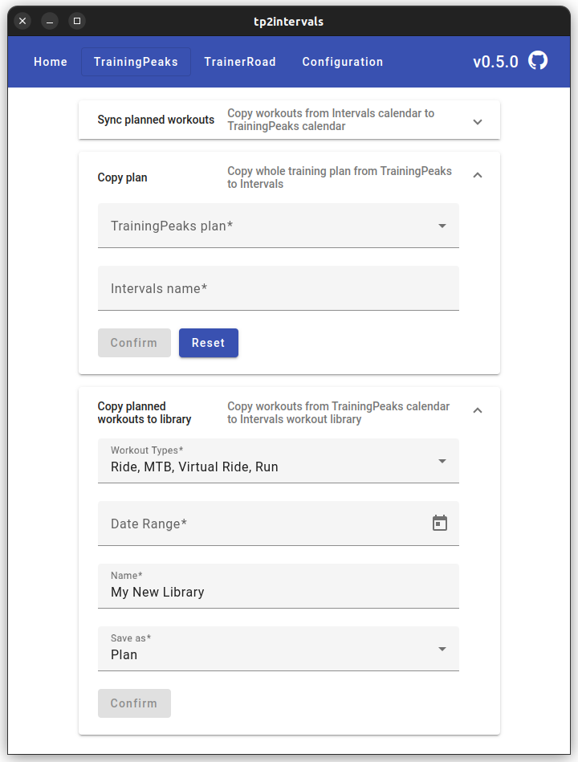
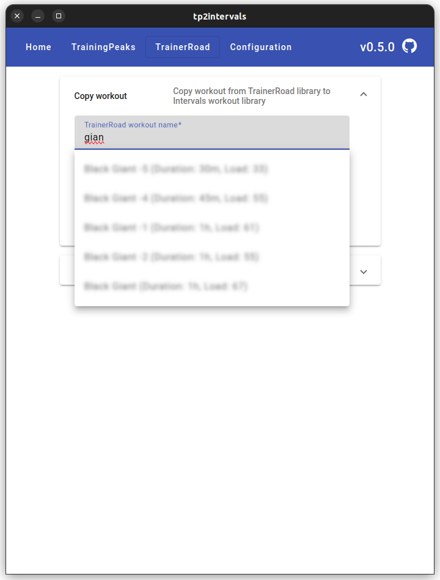
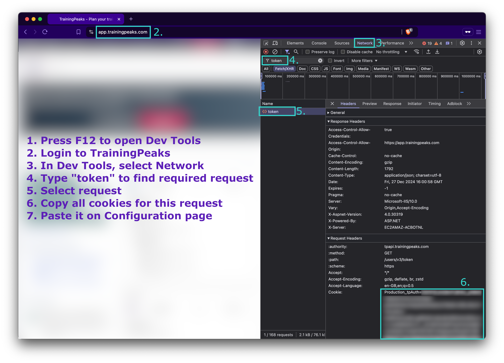
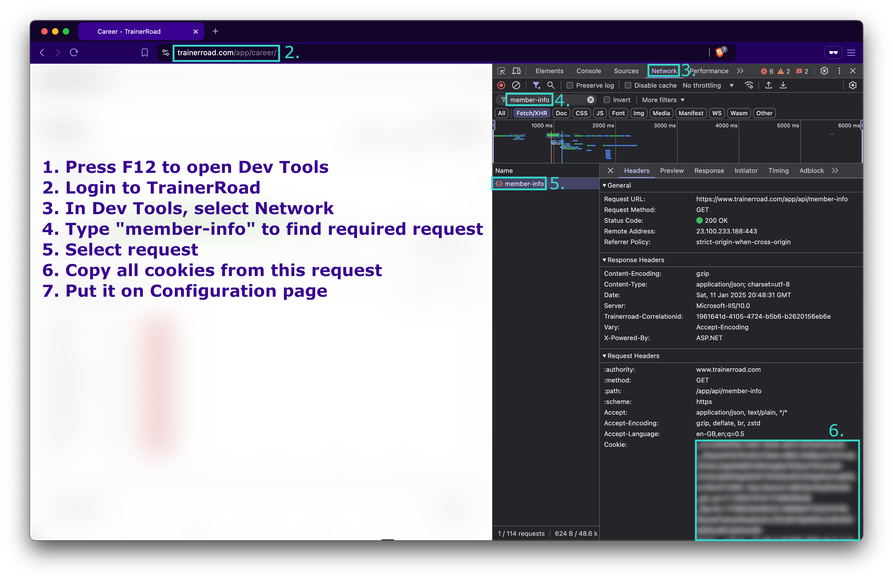
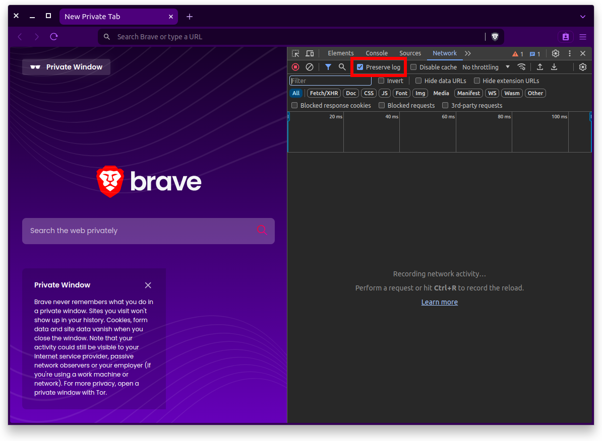
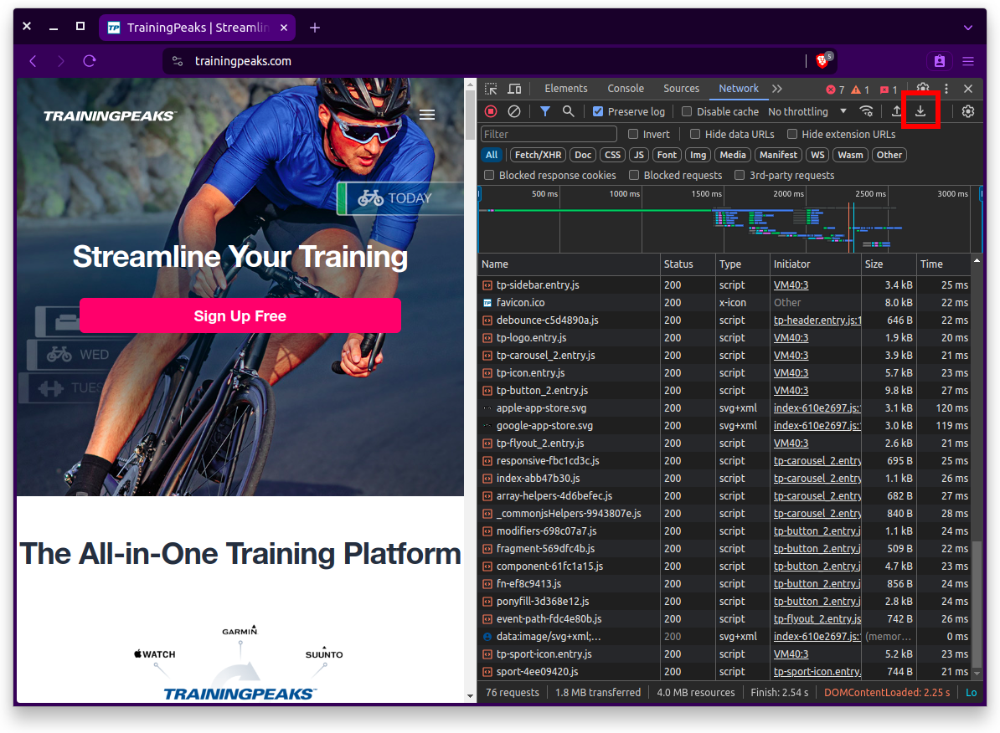

[](https://github.com/freekode/tp2intervals/actions/workflows/branch.yml)
[](https://github.com/freekode/tp2intervals/releases/latest)

[](https://ko-fi.com/E1E6W6XZP)

# Third Party to Intervals.icu

App to sync workouts between TrainingPeaks, TrainerRoad and Intervals.icu.

Runs on MacOS (DMG), Windows (EXE installer), Linux (AppImage). Alternatively there is Docker image and executable JAR.

All files are available for download on [Release page](https://github.com/freekode/tp2intervals/releases/latest).

**Only for educational purposes**



* [List of features](#list-of-features)
* [Configuration](#configuration)
    + [Intervals.icu](#intervalsicu)
    + [TrainingPeaks](#trainingpeaks)
    + [TrainerRoad](#trainerroad)
* [Other ways to run the app](#other-ways-to-run-the-app)
    + [Executable JAR](#executable-jar)
    + [Docker](#docker)
* [FAQ](#faq)
    + [General](#general)
    + [Info regarding scheduling for the next day with TrainingPeaks free account](#info-regarding-scheduling-for-the-next-day-with-trainingpeaks-free-account)
* [Troubleshooting](#troubleshooting)
    + [How to get logs](#how-to-get-logs)
    + [How to record HAR file](#how-to-record-har-file)


**New Docker image location ⚠️**

**New image url: `ghcr.io/freekode/tp2intervals`**

Old image url: `ghcr.io/freekode/tp2intervals/tp2intervals`

**TrainerRoad Updates**

I don't have access to TrainerRoad anymore. Account, which I used, cancelled subscription. I don't use the platform and it's too expensive to have it for occasional fixes.
To fix issues I can only relay on logs and HAR files from you.

## List of features

**TrainingPeaks**

Athlete account
* Sync planned workouts in calendar between Intervals.icu and TrainingPeaks (for today and tomorrow with free TP account)
* Copy whole training plan from TrainingPeaks
* Create training plan or workout folder on Intervals.icu from planned workouts on TrainingPeaks

Coach account
* Copy whole training plan and workout library from TrainingPeaks

**TrainerRoad**
* Sync planned workouts in calendar from TrainerRoad to TrainingPeaks or Intervals.icu
* Copy workouts from TrainerRoad library to Intervals
* Create training plan or workout folder on Intervals.icu from planned workouts on TrainerRoad

Automatically schedule workouts for today, by checking your calendar every 3 minutes.
Scheduled jobs persist across restarts; remove them using the delete button in the UI.

For TrainerRoad to Intervals.icu or TrainingPeaks, choose one of two sync behaviours:

* **Add missing only** keeps matching events and copies missing selected workouts.
* **Mirror current TR simulation** updates changed matches, leaves unchanged workouts alone, copies missing workouts and removes stale
  TrainerRoad events. You must explicitly allow stale workout removal before using this mode.
  The confirmation is cleared when you leave Mirror mode or switch to another direction.

Workouts are matched by TrainerRoad ID and day, not by name or content; ambiguous matches are skipped.
Mirror updates or removes destination workouts with a single clear TrainerRoad ID in their
description, regardless of who created them. An event is stale when no TrainerRoad workout with the
same ID and day exists in the selected range, including workouts of unselected types.
For Intervals.icu matches, it compares the event name, type and generated description (including workout
steps). It compares the TrainerRoad start time when present, otherwise the selected default time.
It does not compare a separately edited workout file or `workout_doc`. When neither time is set,
Mirror preserves existing Intervals event times, and new workouts have no start time in Intervals.icu.
The API request uses `00:00` for an unset time, which Intervals.icu treats as not set; an explicitly
selected midnight is therefore indistinguishable from an unset time. A default local time can be set
for integrations such as Hexis.
For TrainingPeaks, Mirror compares the name, mapped workout type, planned duration, load, description,
converted workout structure, and TrainerRoad start time or the default when provided. If neither time
is provided, it preserves the existing planned time; new workouts have no planned time. Times are local.
TrainerRoad descriptions are copied to TrainingPeaks with an appended ID marker. If a description conflicts
with that marker, syncing fails rather than creating a workout that cannot be reliably matched.
It preserves unrelated workout fields when updating and skips workouts whose planned time is missing from
the provider response or invalid, or whose non-empty structure cannot be read. It also skips workouts with
available actual activity metrics, workouts that appear completed or whose completion data is missing, and rechecks
each workout before changing it. The provider does not offer verified atomic conditional writes:
a workout completed between that check and the write could still be changed. Future writes may require
TrainingPeaks Premium.
TrainingPeaks reconciliation uses unofficial API endpoints; planned time writes, update and create
responses have not been verified against a disposable account.
It can overwrite or delete manual edits; an ID does not prove app ownership. If the ID is removed
from an event's description, the app cannot recognize that event and may copy the workout again.
Mirror can remove stale eligible events on empty days and for unselected workout types;
other events are untouched. The TrainerRoad timeline
must cover the selected range. For now, TrainerRoad calendar entries with an explicitly blank title
and no workout ID are assumed to be rest days. Destination titles are not used for this assumption.
This relies on TrainerRoad's unofficial format and may change; a missing title is not treated as blank.
Other TrainerRoad activities without a workout ID are reported for manual review but do not
prevent stale removal. An unidentified or moved TrainerRoad workout can therefore
cause its marked destination workout to be considered stale; review the preview before syncing.
Activities outside the range are ignored.
Choose 2 days (the recommended default), 7 days,
4 weeks (all including today), or a custom range. TrainerRoad's simulated plans may change.
Manual sync previews the affected workouts and identifies existing or unchanged matches by date, name,
and TrainerRoad ID. If the action list or, in Mirror mode, the unidentified
activity dates change before confirmation, sync stops.
Scheduled jobs use the selected behaviour and removal permission, but always run for today only.
Older scheduled Mirror and legacy removal jobs cannot sync under the current policy: delete and recreate them to explicitly
accept the current removal policy. The obsolete local ownership table is left in the database but is no
longer used.
Their latest run and any warnings are displayed with the scheduled job.
Overlapping TrainerRoad syncs are serialized within one application instance; do not run multiple
instances against the same calendar concurrently.
Changes are not transactional: if a request fails, earlier changes may already have succeeded.


## Configuration
Before using the application you need to configure access to platforms.
Access to Intervals.icu is required, access to other platforms is optional.

After you gathered all required configuration, you can click Confirm button.
If everything is fine, you will be redirected to the home page.

If your configuration is wrong. You will see an error that there is no access to particular platform.
Check all your values and save configuration again.

### Intervals.icu
Copy API key and Athlete Id from [Settings page](https://intervals.icu/settings) in Developer Settings section on Intervals.icu web page.

### TrainingPeaks
To use TrainingPeaks copy all cookies from request `https://tpapi.trainingpeaks.com/users/v3/token` and put it on Configuration page.
The app automatically will remove redundant parts and only require cookie will remain. Follow guide below how to do that.

The app requires `Production_tpAuth` cookie (key and value, smth like `Production_tpAuth=very_long_string`).
Another guide is [available here](https://forum.intervals.icu/t/implemented-push-workout-to-wahoo/783/87)



### TrainerRoad
Configuration is very similar to TrainingPeaks. Copy all cookies from request `https://tpapi.trainingpeaks.com/users/v3/token` and put it on Configuration page.
The app automatically will remove redundant parts and only require cookie will remain. Follow guide below how to do that.

Cookie `SharedTrainerRoadAuth` (key and value, smth like `SharedTrainerRoadAuth=very_long_string`) is required for the app.

The unofficial, reverse-engineered API notes and sanitized example responses are documented in
[docs/trainerroad-api/](docs/trainerroad-api/README.md).



Be aware, Firefox cuts long strings in Dev Tool window. Copy cookie value with right click -> Copy Value.

## Other ways to run the app
### Executable JAR
The project has executable jar with web UI. It requires JDK 21. To run jar:
```shell
java -jar tp2intervals.jar
```

By default, UI is available on `http://localhost:8080`. To change port start jar with parameter:
```shell
java -Dserver.port=9090 -jar tp2intervals.jar
```

### Docker
Docker image also built for every release

```yaml
services:
  app:
    image: ghcr.io/freekode/tp2intervals:latest
    container_name: tp2intervals
    volumes:
      - ./tp2intervals.sqlite:/tp2intervals.sqlite
    ports:
      - '8080:8080'
```

## FAQ

### General
* Ramp steps in TrainerRoad are not supported
* **MacOS arm64** Error: `"tp2intervals" is damaged and can’t be opened.`
  Run command in terminal `xattr -d com.apple.quarantine /Applications/tp2intervals.app` and then open app again
* **MacOS** app is not signed. Usually you need to open it twice
* **Windows** The app will ask to access local network and Internet, you need to allow it. After all it makes HTTP requests
* More info you can find on the forum https://forum.intervals.icu/t/tp2intervals-copy-trainingpeaks-and-trainerroad-workouts-plans-to-intervals/63375

### Info regarding scheduling for the next day with TrainingPeaks free account
TrainingPeaks lists planning future workouts as a
[Premium feature](https://help.trainingpeaks.com/hc/en-us/articles/204074014-Basic-vs-Premium-Athlete-Accounts).
Basic accounts may receive HTTP 402 when syncing future workouts. TrainingPeaks' timezone and exact
boundary for this restriction are not verified; earlier observations suggested that some next-day
workouts could be accepted, but do not rely on a specific time to unlock tomorrow.
If a sync fails, check the target calendar before retrying because earlier workouts may already have been added.

Visible time difference with [worldtimebuddy](https://www.worldtimebuddy.com/?pl=1&lid=206,100,756135,2193733&h=206&hf=0)

## Troubleshooting
To identify the problems with any platform, logs from the users helps very much.

Gather logs from [guide below](#how-to-get-logs). And in case of TrainerRoad platform try to [record HAR file](#how-to-record-har-file). Send the files directly to me.

#### How to get logs
1. Go to Configuration
2. In General section check Debug Mode, click Confirm
3. Reproduce your issue
4. Find log file according to your system

* Linux: ~/.config/tp2intervals/logs/main.log
* MacOS: ~/Library/Logs/tp2intervals/main.log
* Windows: %USERPROFILE%\AppData\Roaming\tp2intervals\logs\main.log
* JAR: ./tp2intervals.log

#### How to record HAR file
1. Open new tab in your browser
2. Open dev tools, check Preserve log (Firefox Cog -> Persist Logs)

   
3. Next steps are very important, as they simulate what the app does.
   Open TrainerRoad page, open workout library, find any workout, open workout page (the page where you have chart with workout steps, description, alternatives, etc.)
4. In dev tools, click Export HAR (Firefox - Cog -> Save All as HAR), save the file and send it to me

   

